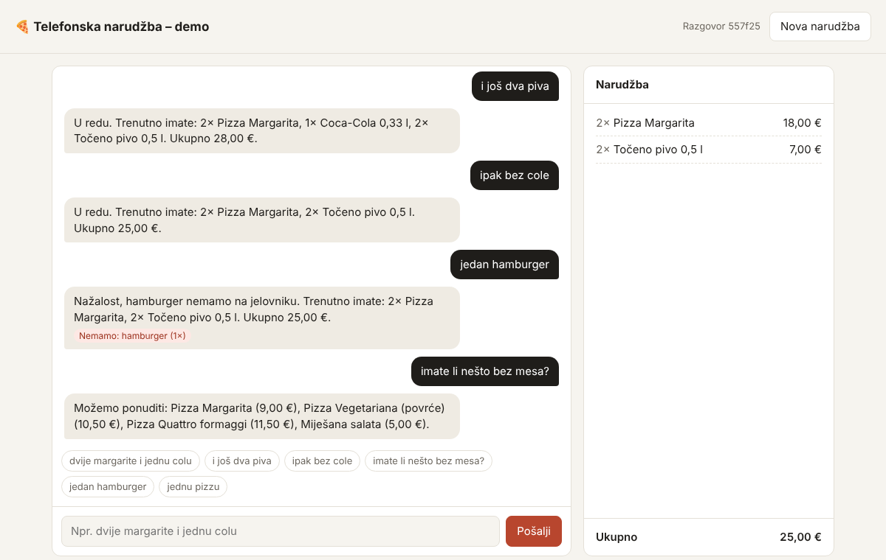

# Restaurant AI Order Taker

A FastAPI service that turns what a guest says on the phone ("dvije margarite i jednu colu")
into a structured order that references the menu (`app/jelovnik.json`), using the free Gemini API.

## Running

Requires Python 3.10+.

```bash
python -m venv .venv
# Windows: .venv\Scripts\activate      macOS/Linux: source .venv/bin/activate
pip install -r requirements-dev.txt

cp .env.example .env        # Windows: copy .env.example .env
# put your key from https://aistudio.google.com/apikey into .env as GEMINI_API_KEY=...

uvicorn app.main:app --reload
```

Then open http://localhost:8000 for a small chat page (see below), or http://localhost:8000/docs for the API.

### With Docker

```bash
docker build -t order-taker .
docker run --rm -p 8000:8000 --env-file .env order-taker
```

The key is passed at runtime and is never baked into the image. The container runs as a non-root user.

The key is read from the `GEMINI_API_KEY` environment variable (a `.env` file is loaded
automatically and is git-ignored). The model defaults to `gemini-3.1-flash-lite` (fast, about 2-3 s per
request, available on the free tier) and can be changed with `GEMINI_MODEL`.
Interactive docs: http://localhost:8000/docs

```bash
curl -X POST http://localhost:8000/order -H "Content-Type: application/json" \
     -d '{"text": "dva hamburgera, dvije margarite i jednu colu"}'
```

```json
{
  "items": [
    {"id": "margarita", "quantity": 2, "name": "Pizza Margarita", "unit_price_eur": 9.0, "line_total_eur": 18.0},
    {"id": "coca_cola", "quantity": 1, "name": "Coca-Cola 0,33 l", "unit_price_eur": 3.0, "line_total_eur": 3.0}
  ],
  "unavailable": [{"text": "hamburger", "quantity": 2}],
  "unclear": [],
  "suggestions": [],
  "intent": "order",
  "total_eur": 21.0,
  "needs_clarification": false,
  "clarification": null
}
```

Other endpoints: `GET /menu`, `GET /health`, and the conversation endpoints below.

## Beyond the task

### Multi-turn conversations: `POST /conversation`

A phone order is a dialogue, not one sentence. `/conversation` keeps the order across the
messages of one call. Send the first message without a `session_id`, then send back the id you get:

```bash
curl -X POST localhost:8000/conversation -H "Content-Type: application/json" -d '{"text": "dvije margarite"}'
# -> {"session_id": "3f2c...", "turn": 1, "items": [margarita x2], ...}
curl -X POST localhost:8000/conversation -H "Content-Type: application/json" \
     -d '{"text": "i jednu colu", "session_id": "3f2c..."}'
# -> items: margarita x2, coca_cola x1
curl -X POST localhost:8000/conversation -H "Content-Type: application/json" \
     -d '{"text": "ipak bez cole", "session_id": "3f2c..."}'
# -> items: margarita x2
```

The response has the same shape as `/order` plus `session_id` and `turn`. `items` is the whole order
so far, while `unavailable`, `unclear` and `suggestions` refer only to the latest message.
`GET /conversation/{id}` returns the current order and `DELETE /conversation/{id}` ends the call.

How it works: the model gets the current order together with the new message and returns the
complete updated order. This handles adding, removing ("ipak bez cole") and changing ("neka budu tri")
with one mechanism. Two guards keep it safe. The same menu validation as `/order` applies, and a
question or small talk mid-call ("imate li nešto bez mesa?") never changes the order, even if the
model forgets to repeat it. Sessions live in memory with a 30-minute idle timeout (`SESSION_TTL_S`).
In production they would live in Redis so several server instances can share them.

### Degraded mode when Gemini is down

If Gemini times out, errors, runs out of quota or returns garbage (after one retry), the service
does not fail. It answers with a rule-based parser (`app/fallback.py`) and marks the response
`"degraded": true`. The fallback recognises menu items by word stems ("kapričozu", "kole",
"četiri sira") and Croatian number words. Unknown items that come with a quantity ("dva hamburgera")
still go to `unavailable`. It does not understand corrections, so when it sees words like "ipak" or
"ma ne" it sets `needs_clarification` and asks the guest to repeat instead of guessing. On a phone
call, a simple honest answer is better than an error. Set `FALLBACK_ENABLED=false` to get plain
`503`/`502` errors instead.

### Chat page for trying it out

`GET /` serves a small chat page (`app/static/index.html`, plain HTML and JavaScript with no build step).
It talks to `/conversation`, shows the order and total as they change, marks unavailable or unclear
items and degraded answers, and turns the structured response into the sentence the assistant would
say back. The buttons under the chat send example sentences.



### Continuous integration

`.github/workflows/ci.yml` runs the test suite and builds the Docker image on every push and pull
request. The tests mock the model, so CI needs no API key.

## Response format

`items` and `unavailable` are exactly the suggested format; each item additionally carries
its name and prices. The extra fields exist because the response feeds a voice assistant
that has to say something back:

| Field | Why |
|---|---|
| `name`, `unit_price_eur`, `line_total_eur`, `total_eur` | The assistant can read the order and total back to the guest for confirmation. Prices come from the menu file, never from the model. |
| `intent` | `order`, `question` or `other`, so the caller knows whether to confirm an order, answer a question, or reprompt. |
| `suggestions` | Answer to questions like "imate li nešto bez mesa?". Nothing is added to `items`. |
| `unclear` | Items that match several menu entries ("jednu pizzu"). They are neither ordered nor reported as unavailable, because the restaurant does have pizza. |
| `needs_clarification`, `clarification` | A short question the assistant can ask the guest (e.g. "Koju pizzu želite?"). |
| `degraded` | `true` when Gemini was unavailable and the rule-based fallback answered. |

## How it works

```
text ─► validation ─► Gemini (structured JSON output) ─► menu validation ─► response
```

1. **Input validation** (`app/schemas.py`): empty, whitespace-only, non-string or over-long
   text gets a `422` without calling the model.
2. **Language understanding** (`app/llm.py`): Gemini receives the menu and the rules in a system
   prompt and must answer in a fixed JSON schema (`response_schema`, temperature 0). For each
   thing the guest mentioned it returns what was heard, the final quantity, and a menu id or `null`.
   The guest's text is delimited and treated as data, which covers basic prompt injection.
3. **Validation against the menu** (`app/service.py`): the model is never trusted blindly.
   - Any id that isn't on the menu (including one the model invented) moves the item to `unavailable` with the guest's own words. Nothing is lost or silently substituted.
   - Quantities ≤ 0 are dropped (cancelled items), large ones are capped at 99 and flagged.
   - Duplicate lines are merged ("margaritu i još dvije margarite" → 3).
   - Meat-free suggestions are computed from the menu's `bez_mesa` flag (food only), not taken from the model.
   - Prices and totals come from the menu file.
4. **Failure handling**: network errors, timeouts, Gemini 5xx and unparsable or schema-invalid model
   output are retried once. Client errors (bad key, unknown model, quota exhausted) are not retried,
   since retrying them only burns quota. The service then answers in degraded mode (see above). With
   the fallback disabled it returns `503` (model unreachable or quota exhausted) or `502` (model
   answered with garbage). A missing API key is always a `503`. It never returns `500`.

Mid-sentence corrections ("tri margarite i colu, ma ne, ipak dvije") are handled by the model,
which is instructed to return only the final state of the order. That is a language problem a
regex cannot solve robustly.

## Tests and evaluation

```bash
pytest                         # 57 fast tests, model mocked, no API key needed
python -m eval.run_eval        # 27 labelled sentences against the real Gemini model
python -m eval.run_eval --conversations   # 6 multi-turn conversations (15 turns) against the real model
python -m eval.run_eval --url http://localhost:8000 --delay 4   # same, against a running server
```

- `tests/` check everything deterministic: the five task examples (with the model's parse mocked),
  invented ids, duplicates, quantity limits, bad input, model timeouts and garbage output, and retries.
- `eval/cases.json` is a small labelled set: the five task examples plus typos, English, unknown items,
  corrections, cancellations, an ambiguous "jednu pizzu", small talk and a prompt-injection attempt.
  `run_eval` prints pass/fail per sentence, overall accuracy and latency, and stops early if the API
  quota runs out.

- `eval/conversations.json` scores every turn of a conversation on the whole order so far.

Latest run with `gemini-3.1-flash-lite`: **27/27 sentences and 15/15 conversation turns passed**.
Median latency was 3 to 9 seconds, depending on load on the free tier. Run the eval with
`FALLBACK_ENABLED=false` so that a model failure shows up as a failure rather than a degraded answer.

## What could be improved, and how to check it works

**Improvements.** The biggest gain would come from a larger evaluation set built from real (transcribed)
phone calls, including speech-to-text errors. That set would also let us compare prompts and models by
numbers rather than by feel. Next would be support for modifiers ("bez luka", "velika"), and storing
conversation sessions in Redis so the service can run on more than one instance.

**Checking it works.** Unit tests guard the deterministic logic on every change. The labelled eval set
is run against the real model before every prompt or model change, tracking exact-match accuracy and
especially the number of *substituted* items, which is the most harmful error. In production I would
log every request, response and the guest's final confirmed order (with consent), and track how often
the guest corrects the assistant. That correction rate is the real-world accuracy metric, and those
logs feed back into the eval set.

## Project layout

```
app/
  main.py        FastAPI app and endpoints
  llm.py         Gemini client, prompt, retry logic
  fallback.py    rule-based parser used when Gemini is down
  sessions.py    in-memory conversation sessions
  service.py     validation of the model output against the menu
  schemas.py     request/response models
  menu.py        menu loading
  config.py      environment configuration
  jelovnik.json  the menu
  static/        the chat page
tests/           pytest suite (model mocked)
eval/            labelled sentences, conversations and the evaluation script (real model)
docs/            screenshot for this README
Dockerfile       container image (python:3.12-slim, non-root)
.github/         CI: tests and Docker build on every push
```
